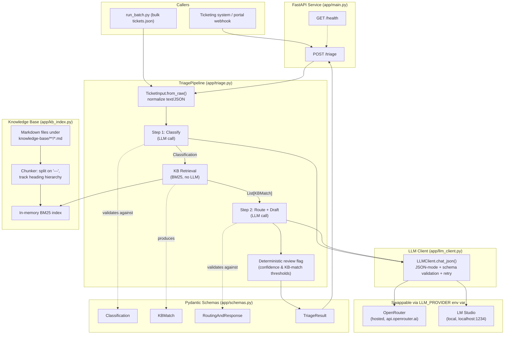
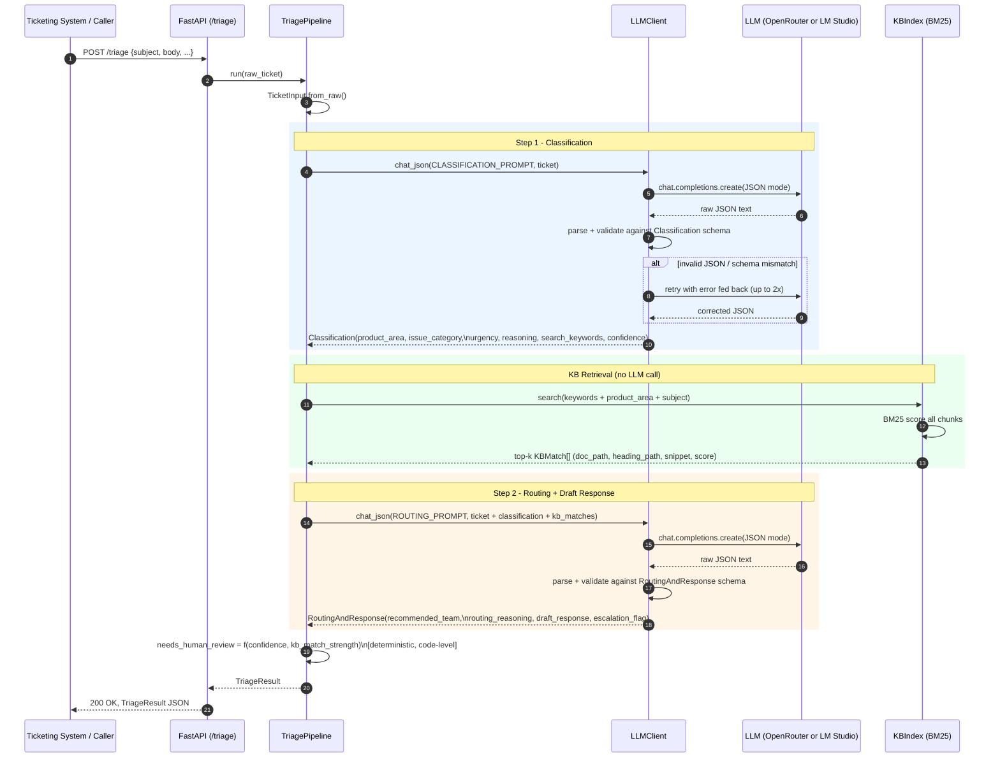

## Intelligent ticket triage agent


An LLM-powered pipeline for Technical Support that ingests a raw support
ticket and produces a structured triage decision — product area, issue
category, urgency (P1–P4) with reasoning, matching knowledge-base
articles, a recommended responder team, and a ready-to-edit first-response
draft — with no human-labelled training data. Exposed as both a callable
**Python function and a FastAPI REST endpoint**.

---

## 1. Approach & Methodology

The brief asked for classification, KB matching, routing, and response
drafting, delivered **without human labelling**. That constraint shaped
every design choice below:

| Requirement | Approach taken |
|---|---|
| Classify without labelled data | Zero-shot LLM classification against a fixed rubric (urgency tiers, category list) — organisational policy, not per-ticket answers |
| Match known issue patterns | Local retrieval over the existing markdown KB, no fine-tuning or embedding training needed |
| Suggest team + draft response | A second LLM pass, grounded in the retrieved KB excerpts, so drafts cite real guidance instead of hallucinating fixes |
| Callable function / REST endpoint | Core logic lives in a plain Python class (`TriagePipeline`); FastAPI is a thin wrapper around it, not a dependency of the logic itself |
| Swappable LLM backend | One OpenAI-compatible client class, since OpenRouter and LM Studio both speak that wire protocol |

**Methodology, step by step:**

1. **Define the taxonomy as policy, not labels.** Wrote the P1–P4 rubric
   and issue-category list once, as prompt content — the same rubric a
   human triager would use, just written down for the model instead of
   inferred from examples.
2. **Normalize heterogeneous input.** `TicketInput.from_raw()` accepts
   either a plain string or the full `tickets.json` record shape, so the
   pipeline isn't coupled to one ticketing system's schema.
3. **Classify first, retrieve second.** Classification produces
   `search_keywords` deliberately, so KB retrieval is driven by
   model-extracted intent (error codes, feature names) rather than raw
   ticket text, which is noisier.
4. **Build retrieval to match the KB's own recommended chunking.**
   Implemented the `---`-boundary, heading-hierarchy-aware chunker exactly
   as specified in the KB README, backed by a dependency-free BM25 index —
   no vector DB, no embedding calls, fully offline-capable.
5. **Ground the draft response in retrieved evidence.** The routing/drafting
   prompt is given the actual KB snippets and instructed not to invent a
   fix if nothing relevant was found — this is the main lever against
   hallucinated troubleshooting advice.
6. **Add a deterministic safety net.** `needs_human_review` is computed in
   plain Python (confidence threshold + KB-match strength), not asked of
   the model — a triage agent shouldn't be the sole judge of its own
   reliability.
7. **Validate everything structurally.** Every LLM response is parsed into
   a Pydantic schema with automatic retry-on-invalid-JSON, so malformed
   output never silently reaches a human agent's queue.

---

## 2. Architecture



### Flow (per ticket)




---

## 3. Tools & Tech Stack

| Layer | Choice | Why |
|---|---|---|
| Language | Python 3.11+ | Team standard, first-class LLM SDK support |
| Structured output | Pydantic v2 | Runtime schema validation on every LLM response, not just type hints |
| LLM access | `openai` SDK against an OpenAI-compatible endpoint | Same client works for OpenRouter *and* LM Studio — no provider-specific SDKs |
| LLM providers | OpenRouter (hosted) / LM Studio (local) | Lets the team develop and demo fully offline (LM Studio), then point at a stronger hosted model with a one-line env change (OpenRouter) |
| Retrieval | Custom BM25 (stdlib + `math` only) | KB is small/medium markdown; avoids standing up a vector DB or paying for embedding calls for a problem keyword search already solves well |
| API layer | FastAPI | Async-ready, auto-generates OpenAPI docs, minimal boilerplate over the core pipeline |
| Testing | `pytest`, with a fake LLM client for pipeline tests | KB/retrieval logic is tested for real; LLM-dependent logic is tested without needing an API key or network in CI |

---

## 4. Implementation Process

1. **Schemas first** (`app/schemas.py`) — defined `TicketInput`,
   `Classification`, `KBMatch`, `RoutingAndResponse`, `TriageResult` before
   writing any prompt or pipeline code, so every downstream component has
   a contract to validate against.
2. **LLM client** (`app/llm_client.py`) — built the provider-agnostic
   wrapper with JSON-mode + schema-validated retry, so prompt iteration
   never has to deal with brittle string parsing.
3. **KB indexer** (`app/kb_index.py`) — implemented the chunking spec from
   the KB README and verified retrieval quality manually against known
   error codes and topics before wiring it into the pipeline.
4. **Prompts** (`app/prompts.py`) — kept isolated from orchestration logic
   so the rubric/wording can be iterated on or eval'd independently of
   `triage.py`.
5. **Orchestration** (`app/triage.py`) — wired classify → retrieve →
   route/draft → deterministic review flag, timing the whole pipeline.
6. **Interfaces** — `app/main.py` (FastAPI) and `run_batch.py` (bulk
   processing of `tickets.json`) as two thin callers of the same
   `TriagePipeline` class, per the "callable function or REST endpoint"
   requirement.
7. **Tests** (`tests/`) — KB tests run against the real sample corpus; a
   `FakeLLMClient` stands in for the model in pipeline tests, so
   `needs_human_review` logic, KB wiring, and latency measurement are all
   verified without a live API key.

---

## 5. Quick Setup Guide

```bash
# 1. Clone/unzip the project, then from its root:
python -m venv .venv

# Windows PowerShell
.\.venv\Scripts\Activate.ps1
# macOS/Linux: source .venv/bin/activate
pip install -r requirements.txt


# 2. Configure your LLM provider
copy .env.example .env
# macOS/Linux: cp .env.example .env
# edit .env — see "LLM Configuration Guide" below

# 3. Drop in your real data (optional — sample data is included)
#    - replace data/tickets.json
#    - replace the data/knowledge-base/ folder

# 4. Run it
uvicorn app.main:app --reload --port 8000        # REST API
# or
python run_batch.py --tickets data/tickets.json  # bulk processing
# or
python -c "from app.triage import TriagePipeline; \
print(TriagePipeline().run({'subject':'test','body':'test'}).model_dump_json(indent=2))"
# or
streamlit run streamlit_app.py    #Streamlit UI

```

**Calling the API:**
```bash
curl -X POST http://localhost:8000/triage \
  -H "Content-Type: application/json" \
  -d '{"subject": "Unable to connect DataBridge Pro to Connectors",
       "body": "Error ERR_CONNECTION_TIMEOUT after 30s, affecting 47 users..."}'
```
A full `tickets.json` record can be POSTed as-is — extra fields
(`account_id`, `status`, `tags`, ...) are simply ignored.

**Running tests (no API key or network required):**
```bash
pytest -v
```

---

## 6. LLM Configuration Guide

Both supported providers expose an OpenAI-compatible `/chat/completions`
endpoint, so `app/llm_client.py` is provider-agnostic — only
`app/config.py`'s environment lookup changes.

### Option A — OpenRouter (hosted)

```env
LLM_PROVIDER=openrouter
OPENROUTER_API_KEY=
OPENROUTER_MODEL=anthropic/claude-3.5-sonnet
```
1. Get a key at https://openrouter.ai/keys.
2. Pick any model from https://openrouter.ai/models and set
   `OPENROUTER_MODEL` (e.g. `openai/gpt-4o`, `anthropic/claude-3.5-sonnet`,
   `google/gemini-flash-1.5`).
3. Use this path for production or any evaluation where output quality
   matters more than infrastructure cost.

### Option B — LM Studio (local, offline)

```env
LLM_PROVIDER=lmstudio
LMSTUDIO_BASE_URL=http://localhost:1234/v1
LMSTUDIO_MODEL=qwen2.5-7b-instruct
```
1. Open LM Studio, download/load a model.
2. Go to the Developer tab → **Start Server**.
3. Set `LMSTUDIO_MODEL` to whatever name LM Studio displays for the
   loaded model.
4. Use this path for offline development, demos without an API key, or
   handling tickets that must never leave the local network.

### Shared tuning knobs

```env
LLM_TEMPERATURE=0.2        # low temperature: consistent classification, not creative writing
LLM_MAX_TOKENS=1024
LLM_TIMEOUT=60
LOW_CONFIDENCE_THRESHOLD=0.55   # below this, needs_human_review = true
KB_MATCH_SCORE_THRESHOLD=0.5    # Bug/Outage tickets below this KB score also flag for review
```

Switching providers never requires touching `app/triage.py`,
`app/prompts.py`, or `app/schemas.py` — only `.env`.

---
## 7. Output

### Python function
```python
from app.triage import TriagePipeline

pipeline = TriagePipeline()  
result = pipeline.run({
    "subject": "Unable to connect DataBridge Pro to Connectors",
    "body": "Error ERR_CONNECTION_TIMEOUT after 30s, affecting 47 users...",
})
print(result.model_dump_json(indent=2))
```

### API endpoints

| Method | Endpoint | Description | Request Body | Response |
|---|---|---|---|---|
| `GET` | `/health` | Checks whether the API is running | None | `{"status": "ok"}` |
| `POST` | `/triage` | Complete pipeline : Classifies, routes, and drafts a response for a support ticket | JSON ticket data with `body` required | `TriageResult` JSON |

### `/triage` Request Example

```json
{
  "subject": "Unable to connect DataBridge Pro to Connectors",
  "body": "The connection fails whenever I try to sync data.",
  "company": "Example Corp",
  "plan_tier": "Business",
  "product": "DataBridge Pro"
}
```

### Streamlit UI


## 8. Key Decisions & Outcomes

| Decision | Rationale | Outcome / trade-off |
|---|---|---|
| Two LLM calls (classify, then route+draft) instead of one | Classification's `search_keywords` output is needed *before* KB retrieval can run, and routing/drafting needs the retrieved excerpts as context | Cleaner separation for eval and debugging, at the cost of roughly double the latency of a single merged call |
| Dependency-free BM25 over embeddings/vector DB | KB is markdown-sized, not web-scale; keyword overlap on error codes and product names is a strong signal | Zero infra cost, works fully offline, instant; would need revisiting if the KB grows to a scale where semantic (not just lexical) matching starts mattering |
| `needs_human_review` computed in code, not asked of the model | A classifier shouldn't be the sole judge of its own reliability | Adds a small, fully auditable rule set on top of the model's self-reported confidence |
| Provider-agnostic LLM client (OpenRouter + LM Studio) | Lets the team develop/demo entirely offline, then flip one env var for production | See the drawback noted below — the choice of *which* model behind that client still matters a great deal |
| Structured output via Pydantic schema + retry-on-invalid-JSON | LLM output must be machine-consumable to reach downstream systems (routing queue, drafted email) | Adds one possible retry round-trip per call; in practice rarely triggered with capable models |

---

## 9. Project Layout

```
triage-pipeline/
├── app/
│   ├── config.py       # env-based config; OpenRouter vs LM Studio
│   ├── llm_client.py   # unified OpenAI-compatible client + JSON-mode/retry
│   ├── schemas.py       # Pydantic models: TicketInput, Classification, TriageResult...
│   ├── prompts.py       # system/user prompt templates
│   ├── kb_index.py      # markdown chunker + dependency-free BM25 retriever
│   ├── triage.py        # orchestrates the two LLM calls + KB retrieval
│   └── main.py          # FastAPI app (POST /triage, GET /health)
├── data/
│   ├── tickets.json             # sample tickets (replace with your own)
│   └── knowledge-base/          # sample KB docs matching your structure
│       ├── products/
│       ├── troubleshooting/
│       ├── billing/
│       └── onboarding/
├── tests/                 # pytest, no network/API key needed
├── run_batch.py           # process every ticket in tickets.json
├── streamlit_app.py
├── requirements.txt
├── .env.example
├── README.md               # this file
└── DESIGN_NOTE.md    
```

---

## 10. Extending Further

- **Merge the two LLM calls** into one once prompt quality is validated,
  to cut latency/cost roughly in half — trade-off discussed in the
  design note.
- **Swap BM25 for embeddings** if the KB grows large enough that lexical
  overlap stops being a reliable signal — only `kb_index.py` changes.
- **Add a routing config file** (e.g. `routing_rules.yaml` mapping product
  area → team) so well-known areas route deterministically, with the LLM
  only handling ambiguous cases.
- **Add an eval harness** using the `category`/`urgency` fields already
  present in a real `tickets.json` as a held-out comparison set — never
  fed into the prompt, only used afterwards to score agreement.

See **`DESIGN_NOTE.md`** for failure modes, the latency/quality
trade-off made in this design, data-sensitivity handling, and expected
behaviour at 10× ticket volume.